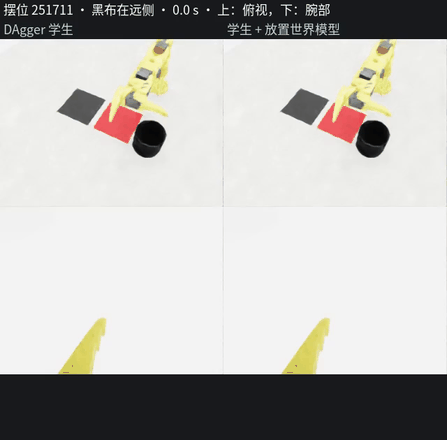

# SO-101 Rim Grasp | 单卡 π0.5 薄壁罐抓放

[English](docs/english.md) · [实验与消融](docs/experiments.md) · [复现](docs/reproduce.md) · [真机记录](real/README.md)

用低成本 SO-101 夹起一个开口黑罐，一指在罐内、一指在罐外，再把**整个罐底**放进黑布。红布是干扰项，两块布会换边。这个项目研究两个具体问题：π0.5 能不能从自己犯过的错里学会选落点？如果它选对了颜色，却把点选在布边，能不能在松爪**之前**判断出来？

[](media/student-vs-world-model.mp4)

**[看原速双栏视频，21 秒](media/student-vs-world-model.mp4)**：约 0:10 开始选点。左边，π0.5 找对黑布，但罐底越界 **31.1 mm**；右边，世界模型比较候选后改选，实放留边 **20.9 mm**。两边从同一次抓稳后的状态出发，用同一个搬放程序。画面中的预测值和最终实测值分开标注。

## 我做了什么

1. **从动作模仿开始。** 在 Isaac Sim 中建空心罐和双相机场景。先用带真值的几何专家验证抓法，再用示范后训练 [LeRobot π0.5](https://huggingface.co/lerobot/pi05_base) 的动作 LoRA。黑布阶段用 12 条完整专家轨迹，得到了能接近、闭爪但容易抓空的策略。
2. **抓偏就重新瞄准。** 从执行过的 32 条抓取轨迹学习一个小模型，预测“原样继续”和“根据俯视与腕部 RGB 重抓”两种选择的离桌高度与倾角。在 8 个开发条件里，原策略稳提 1/8；固定每次视觉重抓和模型选重抓都是 8/8。**有效的是视觉重抓；这组数据没有证明学习型选择器胜过固定重抓。**
3. **把“放哪里”单独教给 π0.5。** 从抓取适配器另起一份落点 LoRA，用双相机、六关节和固定黑布指令预测俯视像素。先用 19 对换色摆位蒸馏视觉教师，再在学生实际到达的 8 对新摆位上标注纠偏，混合旧数据做一轮 **DAgger 式后训练**。只更新 **643,584 个参数**。这是决策点模仿，不是逐关节强化学习。
4. **让放置世界模型在推理时选点。** 在同一持罐状态下实际执行不同落点，得到 39 个去重的动作后果样本。模型按候选点预测落色、整底留边和稳定性，再选点或不放。**搬运、下降、松爪和撤手始终由固定 IK 程序执行。** 两个世界模型都预测少量物理量，不生成视频。

## 结果

| 放置阶段由谁选点 | 开发 A | 开发 B | 如何理解 |
|---|---:|---:|---|
| 纠偏前的落点 LoRA | 4/8 | 未测 | 不是未经微调的 π0.5 |
| DAgger 后的落点 LoRA 独立选点 | **7/8** | **7/8** | 共 **14/16**；没有放置专家或放置世界模型兜底 |
| 同一学生 + 在线放置世界模型 | **8/8** | **8/8** | 共 **16/16**；分别救回一次越界、一次没确认落点 |
| 手写视觉边界规则 | 7/8 | 8/8 | B 版规则在专家漏检时保留学生点；两列并非完全相同的规则 |

两组共 **8 个物理摆位，每个交换一次颜色**。同一起点只抓一次，各方法共享持罐前段，抓取世界模型都是开启的。严格成功要求曾连续稳提至少 0.4 秒，最后连续 2 秒整底在黑布内、罐体稳定、夹爪张开且已分离。**这是小规模仿真开发集，不是真机、封存测试或端到端 π0.5 成功率。**

## 还值得看的三段

| 回放 | 看点 |
|---|---|
| [五种方法，同一组起点](media/dagger-world-model.mp4) | **1:04 起**，黑布换到近侧：旧学生放红，视觉专家三帧漏检；新学生自己放到了黑布。 |
| [故意给错目标：成功与失败，23 秒](media/candidate-probes.mp4) | 前半段从红布纠回；**0:11.6 起**，世界模型漏掉黑布边缘，手写规则却纠正了。32 个注入提案中：不改 **8/32**，世界模型 **28/32**，规则 **32/32**。这是候选选择题，不是 32 次自主抓放。 |
| [抓取三路实录](media/wm-home-comparison.mp4) | 原策略、固定视觉重抓、世界模型在线选择。两路图像都出自仿真传感器。 |

另有[全部 8 个自然起点](media/natural.mp4)、[独立 RL-token 抓取实验](media/expert-reference-actor-01.mp4)，以及[薄罐沿为何难抓的论文笔记](docs/rim-grasp.md)。**单卡资源：**RTX PRO 5000 Blackwell，48 GB 级别；rank 8、BF16。早期单独的动作 LoRA 训练日志约 **9.70 GB**，不是开着 Isaac Sim 时的总峰值。详细预算和失败实验见[实验记录](docs/experiments.md)。

## 复核与真机

```bash
python tools/audit.py          # 标准库，从逐回合记录重算上表
```

[CPU 重放、单卡训练与仿真入口](docs/reproduce.md) · [训练与开发观测格式](data/README.md) · [许可证和上游模型](NOTICE.md)

**实机状态：有 SO-101 和双相机，尚无这项任务的实机成绩。** [真机页](real/README.md)已预留视频和逐次记录。第一项验证是电机不动，只在真实双相机画面上检查罐沿与落点；之后分别记录稳提、滑脱或压痕、整底入布。仿真和实机的分母不会混在一起。
