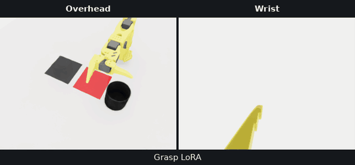
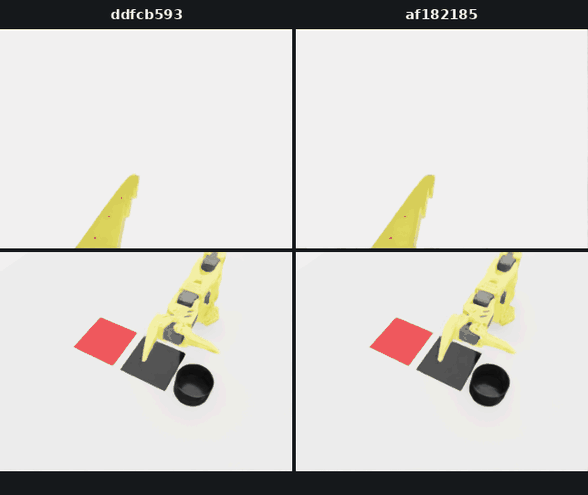
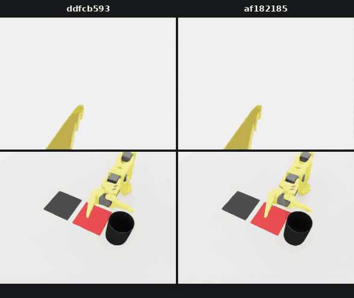
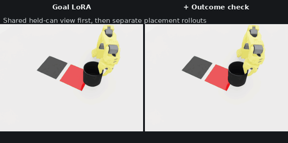

# SO-101 薄壁罐抓放

[English](docs/english.md) · [实验与消融](docs/experiments.md) · [复现](docs/reproduce.md) · [真机记录](real/README.md)

**SO-101 能否夹住开口薄壁罐沿，再将罐子放到指定布面内？** 本项目在 Isaac Sim 中，以单卡 π0.5 微调、模仿学习和 DAgger 研究抓取与放置。

策略按功能拆成两个 LoRA：抓取 LoRA 输出关节动作块；放置 LoRA 预测俯视图中的像素落点，再由固定几何逆运动学（IK）执行搬运、下降、松爪和撤离。它们是任务专用模块，**不是两个端到端关节动作策略**。当前放置任务固定以黑布为目标，红布为干扰项，两块布会交换位置。

## 两个任务模块

| 模块 | 输出 | 训练方式 |
|---|---|---|
| 抓取 LoRA `af182185` | π0.5 关节动作块，用于接近、闭爪和抬升 | 从 `ddfcb593` 继续做 DAgger；混合学生状态上的专家纠偏与已验证的成功回放 |
| 放置 LoRA `9549e9c8` | 俯视图像素落点 | 从 `d7148f68` 继续训练；在学生到达的新状态上标注，并回放旧放置样本 |
| 放置执行器 | 搬运、下降、松爪、撤离 | 固定几何 IK，不由放置 LoRA 生成关节轨迹 |

这里的 DAgger 是让学生先走到自己的状态，再由专家纠偏，并把有效纠偏与已验证的成功经验一起用于训练；参数更新使用监督式模仿学习（SFT）的动作回归损失。专家介入后仍失败的分支，不作为正确动作标签。

`af182185` 使用 **138 个窗口**：5 个历史纠偏、17 个新纠偏、116 个成功能力回放。每个训练 batch 含 2 个纠偏窗口和 2 个回放窗口。冻结 π0.5 基座，仅训练 rank 8、alpha 16 的 LoRA，学习率 `1.5e-5`，共 80 步；683 个控制帧含手臂专家动作标签，**夹爪没有专家纠偏标签**。训练进程峰值显存分配为 10.76 GiB。

放置 LoRA `9549e9c8` 使用 19 对旧样本和 8 对新 on-policy 摆位样本，以 rank 8、alpha 16 微调 192 步，更新 643,584 个参数。它预测的是落点，不是关节动作。

## 仿真回放

以下均为 Isaac Sim 仿真。首个 GIF 是同一验证工况的完整抓放对照：左侧为 DAgger 前抓取 LoRA `ddfcb593`，交接前未能持稳罐体；右侧为 DAgger 后 `af182185`，严格完成黑布抓放。两侧起始关节状态相同，放置 LoRA `9549e9c8` 与几何 IK 固定；无世界模型、视觉脚本重抓或人工接管。这是一个代表性配对案例，不代表总体成功率；16 工况完整任务结果为 **1/16 → 2/16**。

| GIF | 内容 |
|---|---|
| [](media/replays/dagger-full-task-pair.mp4) | 左：`ddfcb593` 未持罐到交接；右：`af182185` 严格完成抓放 |
| [](media/replays/pick-place.mp4) | `af182185 + 9549e9c8 + IK` 抓取、搬运并放入黑布 |
| [](media/replays/pick-place-overhang.mp4) | 反例：选对黑布，但罐底越过布边 |
| [](media/replays/grasp-recovery.mp4) | 新开发工况：父版未抓起，候选版稳持 |
| [](media/replays/grasp-regression.mp4) | 取舍：父版稳持，候选版未能持续抬升 |

放置对照从同一专家辅助抓稳观测开始，比较不同落点分支；具体抓取和评估边界见[实验记录](docs/experiments.md)。

| GIF | 内容 |
|---|---|
| [](media/replays/placement-color.mp4) | `d7148f68` 选到红布；`9549e9c8` 选到黑布 |
| [](media/replays/placement-margin.mp4) | 后果预测器拒绝临边落点；搬放仍由 IK 执行 |

## 结果

### 抓取 DAgger

以下为无世界模型、无专家接管、无固定夹爪的抓取对比。“最终稳持”要求回合结束时罐子仍被稳定提起。

| 评测组 | 父版 | DAgger 候选 | 说明 |
|---|---:|---:|---|
| 8 个新开发工况，最终稳持 | 6/8 | **7/8** | 净增加 1 个稳持工况 |
| 8 个矮罐诊断工况，最终稳持 | 1/8 | **4/8** | 净增加 3 个稳持工况 |
| 24 个历史已见工况，最终稳持 | 12/24 | **14/24** | 训练摆位保持检查，不是留出泛化成绩 |

候选版有提升，也有回退，并非所有场景都优于父版。在另一组关闭世界模型的 16 工况完整任务对比中，两版首次持续抬升均为 **15/16**；保持到 IK 放置交接由 **3/16 提升至 9/16**，严格完整成功仅由 **1/16 提升至 2/16**。完整任务还没有解决。

### 放置 DAgger

在 8 个配对开发起点上，放置学生的严格成功由 **4/8 提升至 7/8**。该对照关注落点决策：输入状态来自同一视觉专家抓取分支，每个候选落点均由同一几何 IK 执行。这不能表述成全神经网络抓放。

## 补充：轻量后果模型

两个小型任务专用模型从仿真实际执行结果学习，用于推理时比较已有技能或放置候选。它们不生成视频或任意关节动作，也没有给 π0.5 提供强化学习奖励，是已知任务条件下的附加优化，不是项目主线。

| 模型 | 用途 |
|---|---|
| [抓取后果模型](src/cloth_lift_wm.py) | 闭爪后比较继续执行抓取策略与运行视觉脚本重抓 |
| [放置后果模型](src/cloth_landing_wm.py) | 预测候选落点的最终位置与罐底相对布边的余量 |

两组放置开发评测中，DAgger 落点策略分别为 7/8，加入后果模型后各为 8/8。刻意注入落点的压力测试中，后果模型为 28/32，简单视觉边界规则为 32/32。样本量有限，不能据此声称模型普遍优于几何规则。

按任务拆分 LoRA 已见于其他模块化策略。[2026 BEHAVIOR Challenge 的 WAM 报告](https://arxiv.org/abs/2611.13818)为 picking、placing 等技能训练独立适配器，并用进度估计路由。本项目采用更简单的阶段切换，**不复现该系统，也不把分模块本身称为创新**；尤其放置 LoRA 输出像素点，实际搬放由 IK 完成。

## 范围与复核

- 所有任务结果来自 Isaac Sim 开发或诊断工况，不是真机或封存测试集。
- 训练使用一张 NVIDIA RTX PRO 5000 Blackwell；10.76 GiB 是单独训练进程峰值，不是训练、推理和仿真同时运行的总显存。
- 控制频率为 15 Hz，物理频率为 120 Hz。50 是动作块步数，不是 50 Hz 控制频率。
- 仿真罐壁厚 2 mm 且为刚体；真实罐壁的形变与接触安全尚未验证。
- 仓库不分发 π0.5 基座、分词器或由其微调得到的 LoRA 权重。

```bash
python tools/audit.py
python tools/refit_landing.py
python tools/replay_choices.py
PYTHONPATH=src python -m unittest discover -s tests
```

这些命令用于审计已发布记录和重放落点模型选择，不会重新运行 π0.5。详见[复现说明](docs/reproduce.md)、[数据与评测边界](docs/experiments.md)、[上游模型与许可](NOTICE.md)和[真机试验记录](real/README.md)。
