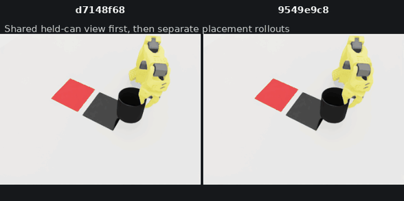
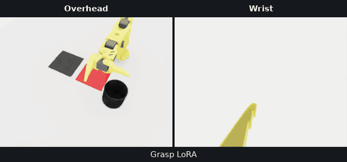

# SO-101 薄罐沿抓放：双 LoRA 与 DAgger

[English](docs/english.md) · [实验与消融](docs/experiments.md) · [复现](docs/reproduce.md) · [真机记录](real/README.md)

在 Isaac Sim 中，SO-101 从罐沿夹起开口薄壁罐，持罐交接后把整个罐底放进黑布。我们用单卡后训练 π0.5 VLA：抓取 LoRA 输出关节动作，放置 LoRA 预测像素落点，几何逆运动学（IK）执行搬放。黑布是目标，红布是干扰，两块布可交换位置。

## 抓取 DAgger 对照

**DAgger 改善了抬起之后的持罐：**在 16 个配对仿真工况中，持罐至放置交接由 **3/16 提升到 9/16**。首次持续抬升两版均为 15/16，严格完整抓放由 1/16 提升到 2/16。对照只更换抓取 LoRA，放置 LoRA 与 IK 固定，关闭世界模型与视觉脚本重抓。

同工况、同初始关节状态。**左：**`ddfcb593` 抬起后在交接前失持。**右：**`af182185` 持罐进入搬放，罐底完整落入黑布。点击 GIF 可看 MP4。

## 双 LoRA 怎么训练

先让学生策略执行，再请专家标注学生实际到达的状态。将新纠偏与旧样本合并，用监督模仿学习更新对应的 LoRA，π0.5 基座保持冻结。按抓取、放置阶段切换技能适配器，也见于 [WAM 的 skill-specific LoRA 设计](https://arxiv.org/abs/2611.13818)。

| 适配器 | 推理输出 | DAgger 训练 |
|---|---|---|
| 抓取 `ddfcb593` → `af182185` | 接近、闭爪、抬升的关节动作块 | 5 个历史纠偏、17 个新纠偏、116 个已验证的能力回放窗口，共 138 个 |
| 放置 `d7148f68` → `9549e9c8` | 俯视图像素落点，交给 IK 搬放 | 19 对旧示范加 8 对学生执行时采集的摆位，由视觉专家标注黑布目标 |

单独评测放置时，固定持罐起点和 IK，严格放置成功由 **4/8 提升到 7/8**。训练超参、成功判据及逐工况对照见[实验与消融](docs/experiments.md)。

## 更多仿真回放

| 放置落点对照 | 整底放置失败 |
|---|---|
|  |  |
| 同一专家辅助持罐起点，放置 LoRA 更新前选红布，更新后选黑布。 | 双 LoRA 与 IK 完成搬放，但罐底越过布边。 |

[完整抓放回放](media/replays/pick-place.mp4) · [抓取改善](media/replays/grasp-recovery.gif) · [抓取回退](media/replays/grasp-regression.gif)

## 运行与真机

抓取 LoRA 使用一张 NVIDIA RTX PRO 5000 Blackwell，训练进程的峰值显存分配为 **10.76 GiB**。当前公开抓放结果来自 Isaac Sim；实体 SO-101 已验证腕部与俯视双相机并发采集，真机抓放待测。见[真机记录](real/README.md)和[薄罐沿抓取背景](docs/rim-grasp.md)。

仓库提供仿真回放、逐回合记录、配对放置数据与放置 LoRA 训练入口。CPU 可复算公开结果并重放记录中的落点选择；依赖、公开文件和模型许可见[复现说明](docs/reproduce.md)与[许可说明](NOTICE.md)。

## 补充：轻量后果模型

我们从仿真执行结果拟合了两个动作条件后果模型：[抓取模型](src/cloth_lift_wm.py)比较继续抓取与视觉脚本重抓，[放置模型](src/cloth_landing_wm.py)按预测落点和布边余量筛选候选。它们用于推理时的分支选择；上方抓取对照关闭了这两个模块。见[辅助实验](docs/experiments.md#辅助实验)和[临边候选回放](media/replays/placement-margin.gif)。
