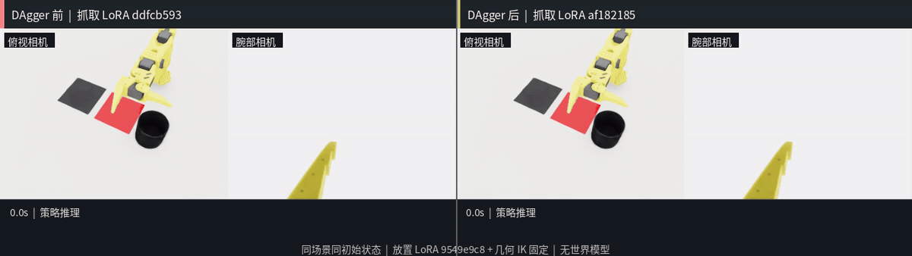
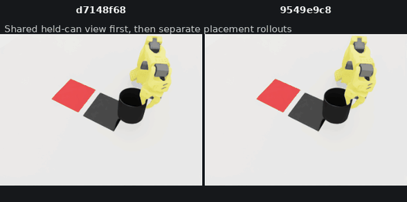
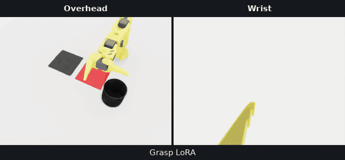

# SO-101 Can-Rim Pick and Place: Two LoRAs and DAgger

[中文](../README.md) · [Experiments](experiments.md) · [Reproduction](reproduce.md) · [Hardware status](../real/README.md)

The task is to grasp an open, thin-walled can by its rim and place the entire base inside a black cloth region in Isaac Sim. We fine-tune π0.5 on one GPU: a grasp adapter predicts joint-action chunks and a placement adapter predicts an overhead pixel goal. Geometric inverse kinematics (IK) executes the carry and release. The black and red cloths swap positions, with red as the distractor.

## DAgger Grasp Comparison

**The grasp DAgger update improved retention after lift.** Across 16 matched simulation conditions, retention at the placement handoff rose from **3/16 to 9/16**. First sustained lift was 15/16 for both adapters; strict full-task completion rose from 1/16 to 2/16. The comparison changes only the grasp adapter, holds the placement LoRA and IK fixed, and disables both world models and scripted visual regrasp.

Both runs start from the same joint state. **Left:** `ddfcb593` lifts the can but loses it before handoff. **Right:** `af182185` holds the can through handoff and places it fully inside the black cloth.

## How the Adapters Are Trained

The learner acts first, and the expert labels states reached during its rollouts. Supervised imitation updates the corresponding adapter with new corrections and prior data while keeping the π0.5 base frozen.

| Adapter update | Inference output | DAgger training data |
|---|---|---|
| Grasp `ddfcb593` → `af182185` | Joint-action chunks for approach, closure, and lift | 138 windows: 5 prior corrections, 17 new corrections, and 116 verified replay windows |
| Placement `d7148f68` → `9549e9c8` | Overhead pixel goal, executed by IK | 19 prior demonstration pairs and 8 on-policy layout pairs with expert black-cloth labels |

In a separate placement comparison with matched held-can starts and fixed IK, strict placement increased from **4/8 to 7/8**. See [experiments and ablations](experiments.md) for training settings, criteria, and per-condition results.

## More Replays

| Placement goal comparison | Placement overhang |
|---|---|
|  |  |
| From the same expert-assisted held-can state, the updated adapter selects the black cloth. | The two adapters and IK carry and release the can, but the base extends past the cloth edge. |

[Standalone success replay](../media/replays/pick-place.mp4) · [Grasp improvement](../media/replays/grasp-recovery.gif) · [Grasp regression](../media/replays/grasp-regression.gif)

## Reproduction and Hardware

The grasp LoRA ran on one NVIDIA RTX PRO 5000 Blackwell, with **10.76 GiB** peak allocation in the training process. Reported task outcomes are from Isaac Sim. Concurrent wrist and overhead RGB capture has been verified on the physical SO-101; hardware pick-and-place trials are pending. See the [reproduction guide](reproduce.md) and [hardware log](../real/README.md).

## Optional Outcome Models

Two lightweight action-conditioned models fit to simulator outcomes score when to continue versus regrasp, and how much edge clearance a proposed placement will leave. They support decision selection at inference time. See the [ablations](experiments.md) and [placement edge replay](../media/replays/placement-margin.gif).
